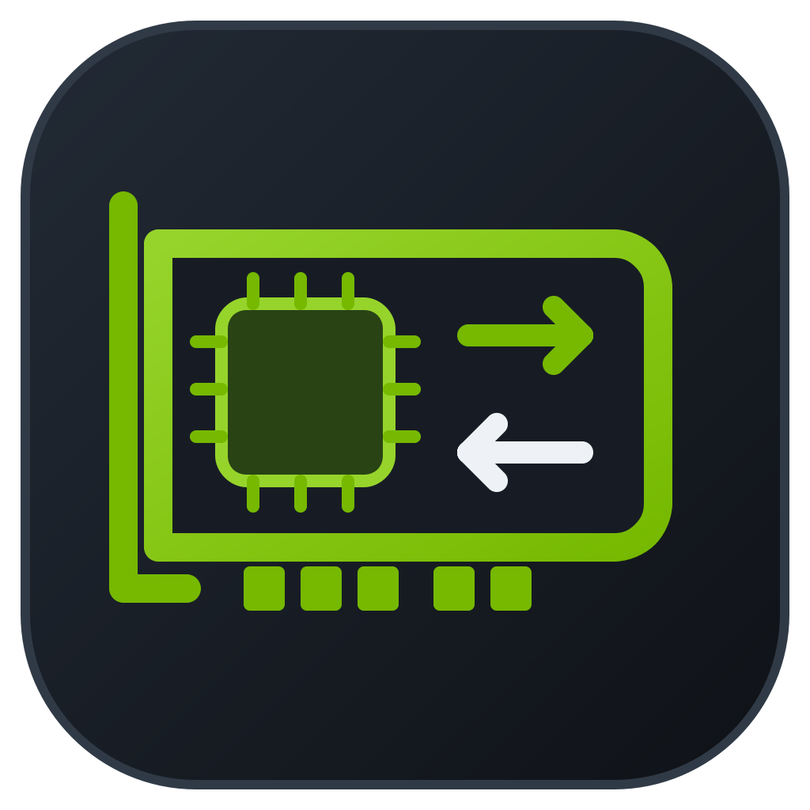
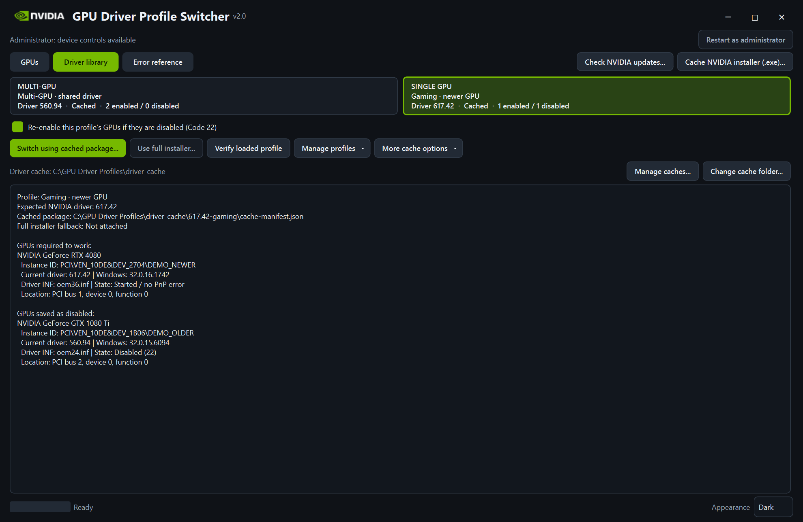
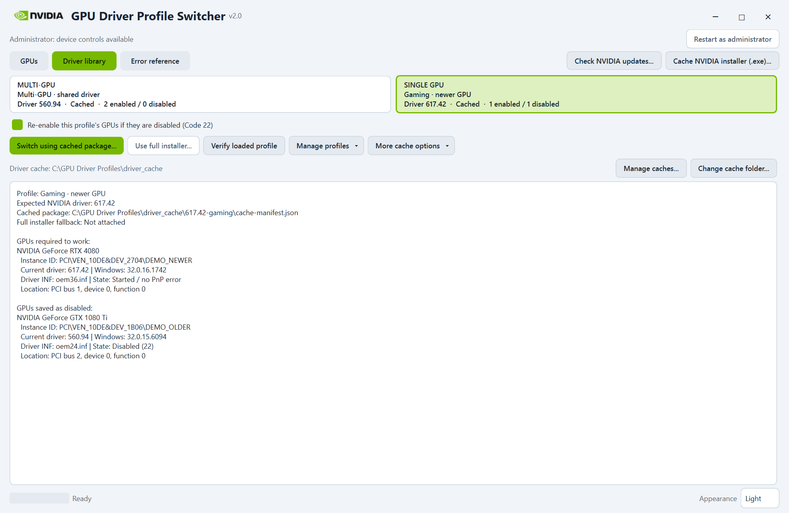
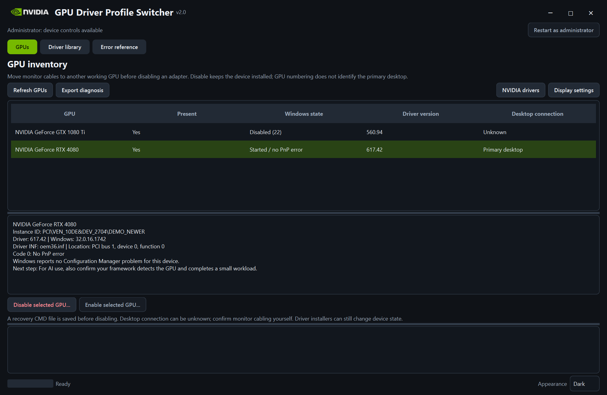
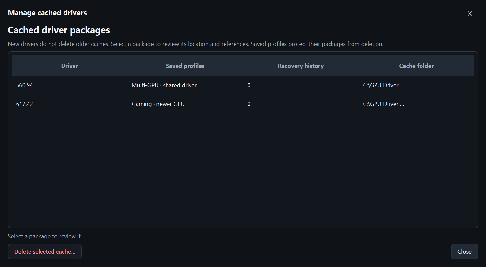
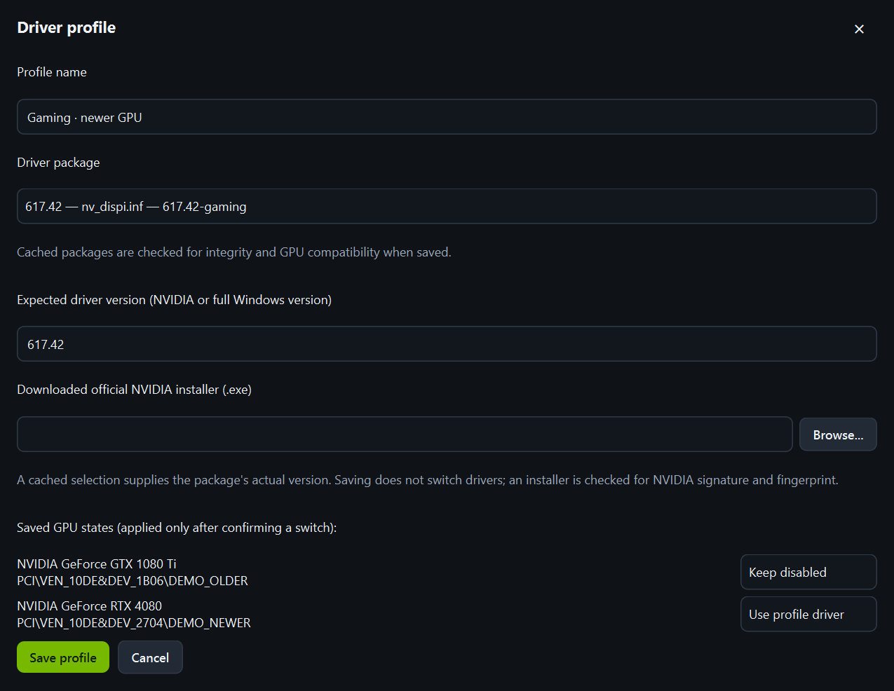
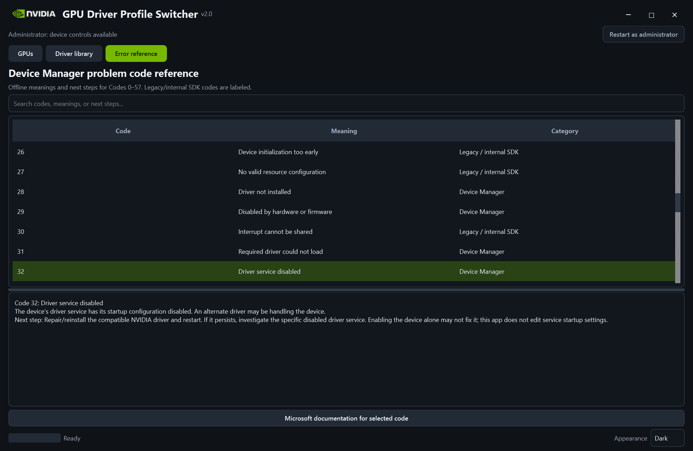

<div align="center">
  
  <h1>NVIDIA GPU Driver Profile Switcher</h1>
  <p><strong>Version 2.0</strong> &nbsp;·&nbsp; Windows 10 / 11 x64 &nbsp;·&nbsp; Qt interface</p>
  <p><a href="https://github.com/snuffy420/NvidiaGPUProfileSwitcher/releases">Downloads</a> &nbsp;·&nbsp; <a href="#screenshots">Screenshots</a> &nbsp;·&nbsp; <a href="#installation">Installation</a> &nbsp;·&nbsp; <a href="#using-profiles">Using profiles</a> &nbsp;·&nbsp; <a href="#contact">Contact</a></p>
</div>

Use **older NVIDIA GPUs alongside newer NVIDIA GPUs** when the newest driver no
longer supports every card in the computer. Save a compatible shared-driver
configuration for local AI or other multi-GPU work, and a newer-driver
configuration for games or applications on the newer cards. Profiles retain
the driver package and the GPUs that should be enabled or disabled.

The program works with NVIDIA cards across generations and product families;
it is not tied to a particular pair of models. Each selected driver must still
support its target hardware. Switching performs a real Windows driver
installation and may require a restart.

## Screenshots

**Driver library · dark theme**



<details>
<summary><strong>Driver library · light theme</strong></summary>



</details>

<table>
  <tr><th>GPU inventory and device controls</th><th>Cached driver management</th></tr>
  <tr>
    <td><a href="assets/screenshots/gpu-inventory.png"></a></td>
    <td><a href="assets/screenshots/cache-manager.png"></a></td>
  </tr>
  <tr><th>Profile editor</th><th>Device Manager error reference</th></tr>
  <tr>
    <td><a href="assets/screenshots/profile-editor.png"></a></td>
    <td><a href="assets/screenshots/error-reference.png"></a></td>
  </tr>
</table>

Screenshots show the actual v2.0 interface with demonstration profiles and
device data. Example GPUs and driver versions are illustrative; they are not
requirements or a list of the latest drivers. Click an image to view it full size.

## What's new in 2.0

See the [full changelog](CHANGELOG.md) for release history.

- **Qt interface:** compact profile cards, green selection highlights, dark/light
  themes, a custom window header, and resizable information panels.
- **Cache locations:** choose a writable driver-cache folder; existing packages
  in the selected folder are detected without moving or deleting them.
- **Cache manager:** review driver versions, locations, saved-profile references,
  and recovery references before deleting a package.
- **Profile package picker:** choose an existing cached version directly, with
  its actual driver version filled in automatically.
- **Distribution options:** a self-contained portable version and a themed Inno
  Setup installer, both using the application icon.

## Features

| Feature | What it does |
| --- | --- |
| Driver profiles | Save an expected driver version and exact GPU instance IDs, including cards that should stay disabled. |
| Cached switching | Retain several display-driver packages and switch using the selected profile's cache. |
| NVIDIA EXE import | Extract and cache an official offline driver installer without executing NVIDIA setup. |
| Installed-driver capture | Preserve a currently installed working version for later use. |
| Update checks | Query NVIDIA's official catalogue for detected GPUs, including disabled adapters, and review offered updates. |
| Device controls | Identify, enable, or disable individual GPUs using Windows device controls. |
| Verification and recovery | Check cached files, hardware compatibility, loaded versions, and saved states; retain history and recovery files. |
| Error reference | Search Device Manager codes 0–57, meanings, and next steps, including Code 32. |

## Downloads

Open [Releases](https://github.com/snuffy420/NvidiaGPUProfileSwitcher/releases)
and choose one package:

| Package | Download | Python needed? |
| --- | --- | --- |
| **Windows installer** | [v2.0 Setup · Windows x64](https://github.com/snuffy420/NvidiaGPUProfileSwitcher/releases/latest/download/NVIDIA-GPU-Driver-Profile-Switcher-v2.0-Setup-Windows-x64.exe) | No |
| **Portable** | [v2.0 Portable · Windows x64 · .7z](https://github.com/snuffy420/NvidiaGPUProfileSwitcher/releases/latest/download/NVIDIA-GPU-Driver-Profile-Switcher-v2.0-Portable-Windows-x64.7z) | No |
| **Python source** | [v2.0 Source · .7z](https://github.com/snuffy420/NvidiaGPUProfileSwitcher/releases/latest/download/NVIDIA-GPU-Driver-Profile-Switcher-v2.0-Source.7z) | 64-bit Python 3.10+ and PyQt6 |

Matching **`.sha256` files** are supplied for the three packages. To check a
download in PowerShell, run `Get-FileHash .\your-downloaded-file -Algorithm SHA256`
and compare the result with the text in its `.sha256` file.

The portable and installer packages include Python, PyQt6/Qt, the application
resources, and the extraction tool. They do not download dependencies at launch.
NVIDIA driver packages are not included; driver downloads occur only when you
choose to download them.

## Installation

Requires **Windows 10 version 2004 or later, or Windows 11, x64**. Administrator
rights are required for GPU/driver changes, not for opening the app or preparing
profiles. Allow enough free disk space for complete extracted driver packages.

### Windows installer

1. Download and run **NVIDIA-GPU-Driver-Profile-Switcher-v2.0-Setup-Windows-x64.exe**.
2. Choose the installation folder and whether to create a desktop shortcut.
3. Open the application from the Start menu or shortcut.

Setup installs for the current Windows account, normally under
`%LOCALAPPDATA%\Programs\NVIDIA GPU Driver Profile Switcher`. This is a writable
location for profiles and settings. Installing the app does not install a GPU
driver or change a device's state. Uninstall removes the program's installed
files; user-created profiles, caches, downloads, and recovery files are retained.

### Portable

1. Extract **NVIDIA-GPU-Driver-Profile-Switcher-v2.0-Portable-Windows-x64.7z**
   using 7-Zip or another compatible extractor.
2. Keep the extracted containing folder intact and put it in a writable location.
3. Double-click the EXE inside it. Do not run the EXE from the archive viewer.

**Why is the EXE inside a folder?** The program creates profile/settings files
and folders beside itself as you use it: `driver_cache`, `downloads`,
`driver_history`, `recovery`, and temporary `.driver_imports` work files.
The containing folder keeps these together instead of scattering them across
your Desktop or Downloads folder. Move the whole application folder if you
relocate it. The `assets` folder also carries the application icon.

### Python source

1. Install **64-bit Python 3.10 or later** and extract the source package.
2. In the project folder, run:

   ```powershell
   py -3 -m pip install -r requirements.txt
   ```

3. Double-click **NVIDIA GPU Driver Profile Switcher.vbs** for a console-free
   launch, or use the CMD launcher to see startup diagnostics.

Version 2.0 uses **PyQt6**, not Tkinter. Keep the Python modules, `requirements.txt`,
`assets`, and `tools` together. Use the same Python installation for pip and the
application; `py -3 gpu_manager.py` also starts it directly.

## Using profiles

### 1. Preserve the shared configuration

Start with the GPUs working on a driver compatible with your AI or multi-GPU
environment. In **Driver library → Manage profiles → Capture working drivers**,
save the configuration. Then use **More cache options → Cache saved profiles**
to preserve the matching complete driver package from Windows.

### 2. Prepare the newer-driver configuration

Use **Cache NVIDIA installer (.exe)…** to import an official offline installer,
or **More cache options → Cache installed version…** to retain an installed
version. A new package does not replace your older cached versions.

Under **Manage profiles → Add profile… / Edit selected…**, choose a cached
**Driver package** and give each GPU a role:

| Role | When switching to this profile |
| --- | --- |
| **Use profile driver** | Install the profile's driver for this GPU and verify it. |
| **Keep disabled** | Disable or retain the disabled state of this GPU; preserve its installed package. |
| **Leave unchanged** | Do not make this GPU a target of the profile. |

The package picker fills the expected version from cached metadata. Saving
checks cache integrity and target compatibility without switching drivers.
New profiles use the healthy enabled GPUs' current version and preserve disabled
adapters. If healthy GPUs have different versions, choose a version explicitly.

### 3. Select, switch, and verify

Click a profile card; the selected card is highlighted green. Selecting it only
changes the selection. Use **Restart as administrator** when ready to make a
device or driver change, then **Switch using cached package…** and review the
confirmation. **Verify loaded profile** checks the loaded versions and saved
device states afterward. **Use full installer…** remains available when an
official installer has been attached to the profile.

Close games and AI workloads before a switch. Displays may briefly go blank;
restart Windows if it requests one. A working Device Manager state and matching
driver version do not prove CUDA/framework compatibility—test your actual AI
workload after changing drivers. Profiles cannot add hardware support that the
chosen NVIDIA driver does not provide or create independent active NVIDIA
driver stacks for different applications.

## Managing the cache

- **Change cache folder…** selects an existing writable location and scans it
  for app-cached packages. It does not move or delete files or create profiles.
- Existing packages remain in their original locations. Current and previously
  selected cache roots stay available to saved profiles and the package picker.
- **Manage caches…** shows package versions, locations, saved-profile references,
  and recovery-history references.
- Packages used by saved profiles cannot be deleted through the cache manager.
  Deleting a recovery-referenced package requires an additional confirmation.
- Deleting a cached copy does not uninstall the Windows driver or remove the
  original NVIDIA installer.

Cache manifests contain absolute paths. Keep cache folders accessible; after
moving a package, reimport or recache it and update the affected profile.

## NVIDIA updates and EXE import

**Check NVIDIA updates…** uses NVIDIA's public product catalogue and detected
GPU names, including disabled cards. Choose a single-GPU update or an offered
common package supported by all selected targets. An ambiguous lookup or failed
request is not treated as “up to date”; manual EXE import remains available.

Downloaded installers are checked for NVIDIA Authenticode signatures and
fingerprints. The bundled `7zr.exe` extracts the display-driver files without
executing the installer. Package versions come from INF metadata, and Windows
checks hardware compatibility. Importing or caching does not stage a package,
switch a driver, or enable a device. A confirmed switch is a separate action.

## Device controls and troubleshooting

The **GPUs** tab shows detected adapters, exact instance IDs, loaded NVIDIA and
Windows driver versions, INF names, PnP states, and available desktop information.
**Export diagnosis** saves the displayed inventory. The **Error reference** tab
contains offline meanings and next steps for Device Manager codes 0–57.

Before disabling an adapter, connect monitors to another working GPU. The app
guards known desktop/last-working adapters and saves a recovery CMD file before
disabling. Desktop detection can be unknown, so confirm monitor cabling yourself.

For **Code 32**, Windows reports that the device's driver service is disabled.
Review the app's code reference and [Microsoft's Device Manager documentation](https://learn.microsoft.com/en-us/windows-hardware/drivers/install/device-manager-error-messages)
before making changes. The application does not change driver-service startup
settings automatically.

## Existing v1.0 users

Back up your application folder, `driver_profiles.json`, `ui_settings.json`, and
cache locations before replacing the app. Keep those data files and your cached
packages; the downloads contain no preconfigured profiles. If you put v2.0 in a
different folder, copy your profile/settings files deliberately and select the
existing cache location. Profile GPU IDs are specific to the machine on which
they were captured. Verify loaded profiles after upgrading.

## Building the Windows releases

Build on Windows x64 with x64 Python and [Inno Setup 6.7+](https://jrsoftware.org/isdl.php):

```powershell
py -3 -m pip install -r requirements.txt pyinstaller
py -3 tools/build_exe.py
py -3 tools/build_installer.py --compiler "C:\Program Files (x86)\Inno Setup 6\ISCC.exe"
py -3 tools/build_release.py
```

Release assets and SHA-256 files are written to `dist/v2.0-github`. The source
builder also produces a repository ZIP containing the README and screenshots.
The build packages use explicit file lists and exclude local configurations,
driver packages, history, recovery data, and internal tests.

The original vector application icon is in `assets/app-icon.svg`. Regenerating
its PNG/ICO files and installer artwork with `tools/create_installer_art.py`
also requires Pillow (`py -3 -m pip install Pillow`). Ordinary builds use the
provided artwork and do not require Pillow. The build script isolates DLL
discovery from unrelated tools' PATH entries and rejects bundled Windows
runtime shims that could interfere with Qt startup.

## License and project information

Created by **snuffy420 / zerØ software**. This is an independent community
project; it is not an NVIDIA product and is not affiliated with NVIDIA.

Project source: [MIT](LICENSE). Bundled PyQt6, Qt, Python, 7-Zip, and NVIDIA
branding have their own terms; see [NOTICE.md](NOTICE.md) and `licenses` in the
binary packages. No NVIDIA drivers are redistributed with the application.

## Contact

<p align="center">
 <a href="https://snuffy420.github.io/NvidiaGPUProfileSwitcher/docs/contact.html">
  
 </a>
</p>

[Report an issue](https://github.com/snuffy420/NvidiaGPUProfileSwitcher/issues)
or [use the contact page](https://snuffy420.github.io/NvidiaGPUProfileSwitcher/docs/contact.html).
